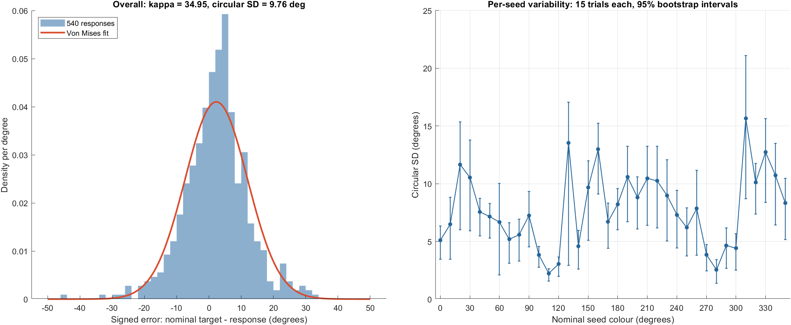

# Completed mapping session: response variability

Retained raw data: mapping_yl_s1_2026-11-05_10-32-18-196.mat.
The session is marked complete and contains all 540 planned main trials plus
all 5 planned practice trials. Each of the 36 nominal seed hues has 15 main
responses. No main trials timed out or had missing response errors. All 540
main trials were used; practice trials were excluded. No outliers were removed.

## Incomplete-file cleanup

Nine incomplete test/checkpoint MAT files were removed after checking their
completion flags and trial counts. Six had no completed trials, two had 2 practice trials each, and one had
36 practice plus 108 main trials (nine total).
The retained complete MAT file was verified unchanged. The original inventory
is in session_inventory.csv; removed_incomplete_sessions.csv lists the deleted
files. The script creates an initial checkpoint before instructions and updates
it after each completed trial, so quitting/crashing leaves a test checkpoint.

## Overall fit

A single von Mises distribution was fitted by maximum likelihood to the signed
errors (nominal target minus wheel-corrected response), with mean direction
estimated freely. Dispersion is fitted about that mean rather than forced zero.

- Trials: **540**.
- Mean signed error: **+2.29 degrees**.
- Concentration **kappa = 34.95**, 95% bootstrap interval **30.50–40.66**.
- Inverse concentration **1/kappa = 0.02861**.
- Normal-limit von Mises width **1/sqrt(kappa) = 0.16914 radians = 9.69 degrees**.
- Exact circular SD **9.76 degrees**, 95% interval **9.04–10.46 degrees**.

Kappa is concentration: larger values mean narrower responses. The normal-limit
width is an approximation, not the exact circular SD. Circular SD is computed
as sqrt(-2 log(Rbar)), converted to degrees. For the fitted von Mises, Rbar equals
I1(kappa)/I0(kappa). Kappa was solved from this equation with scaled Bessel
functions; each solution was checked numerically. The term dispersion is used
in different ways, so both inverse concentration and angular width are supplied.

Confidence intervals use 5,000 nonparametric bootstrap replicates with a fixed
RNG seed. Overall resampling is stratified by seed hue, preserving 15 trials
per seed. Per-seed resampling occurs within each seed. These are descriptive
single-session estimates, not a test of which hues differ. No small-sample
bias correction was applied to the maximum-likelihood kappa estimates.

## Per-seed results

Every row uses **15 responses**, fitting its own mean direction and concentration.
Seed labels are the nominal labels stored in the experiment. The original
one-based palette lookup means physical RGB hue is seed minus one degree,
wrapped around 360: nominal 0 displays RGB hue 359. This constant offset changes
bias interpretation but not the within-seed spread.

| Seed (deg) | Mean error (deg) | Kappa | 1/kappa | VM width (deg) | Circular SD (deg) | SD 95% interval (deg) |
|---:|---:|---:|---:|---:|---:|:---|
| 0 | 7.10 | 126.64 | 0.00790 | 5.09 | 5.10 | 3.45–6.32 |
| 10 | 10.71 | 78.51 | 0.01274 | 6.47 | 6.49 | 3.44–8.82 |
| 20 | 8.05 | 24.68 | 0.04052 | 11.53 | 11.65 | 6.00–15.35 |
| 30 | -10.38 | 30.09 | 0.03324 | 10.45 | 10.53 | 5.91–13.77 |
| 40 | -2.81 | 58.00 | 0.01724 | 7.52 | 7.56 | 5.47–8.72 |
| 50 | 0.49 | 64.62 | 0.01547 | 7.13 | 7.16 | 5.27–8.29 |
| 60 | 0.40 | 74.23 | 0.01347 | 6.65 | 6.67 | 2.10–10.02 |
| 70 | 0.23 | 122.19 | 0.00818 | 5.18 | 5.19 | 3.12–6.61 |
| 80 | 6.27 | 105.95 | 0.00944 | 5.57 | 5.58 | 3.31–6.94 |
| 90 | 3.25 | 63.08 | 0.01585 | 7.21 | 7.24 | 4.52–9.34 |
| 100 | 0.89 | 223.85 | 0.00447 | 3.83 | 3.83 | 2.77–4.56 |
| 110 | 0.77 | 665.78 | 0.00150 | 2.22 | 2.22 | 1.55–2.62 |
| 120 | 0.96 | 353.67 | 0.00283 | 3.05 | 3.05 | 1.97–3.66 |
| 130 | -2.21 | 18.43 | 0.05425 | 13.34 | 13.53 | 2.93–17.05 |
| 140 | 7.99 | 157.06 | 0.00637 | 4.57 | 4.58 | 2.61–5.96 |
| 150 | 13.48 | 35.57 | 0.02811 | 9.61 | 9.68 | 5.09–11.98 |
| 160 | 11.72 | 19.97 | 0.05008 | 12.82 | 12.99 | 9.12–15.24 |
| 170 | 2.84 | 73.54 | 0.01360 | 6.68 | 6.70 | 4.39–8.33 |
| 180 | -0.03 | 49.13 | 0.02035 | 8.17 | 8.22 | 6.00–9.57 |
| 190 | -7.84 | 29.80 | 0.03355 | 10.50 | 10.59 | 6.72–13.25 |
| 200 | -2.13 | 42.79 | 0.02337 | 8.76 | 8.81 | 6.08–10.60 |
| 210 | 6.43 | 30.50 | 0.03278 | 10.37 | 10.46 | 6.38–13.25 |
| 220 | 1.41 | 31.73 | 0.03151 | 10.17 | 10.25 | 6.18–13.25 |
| 230 | 0.02 | 41.27 | 0.02423 | 8.92 | 8.97 | 5.03–12.06 |
| 240 | -1.80 | 62.17 | 0.01608 | 7.27 | 7.30 | 4.43–9.42 |
| 250 | 0.29 | 85.63 | 0.01168 | 6.19 | 6.21 | 3.73–7.91 |
| 260 | 0.26 | 53.71 | 0.01862 | 7.82 | 7.86 | 3.79–11.14 |
| 270 | -0.71 | 222.61 | 0.00449 | 3.84 | 3.84 | 2.44–4.72 |
| 280 | 4.54 | 506.52 | 0.00197 | 2.55 | 2.55 | 1.39–3.41 |
| 290 | 3.32 | 152.77 | 0.00655 | 4.64 | 4.64 | 2.67–6.17 |
| 300 | 4.75 | 168.70 | 0.00593 | 4.41 | 4.42 | 2.49–5.66 |
| 310 | -2.97 | 13.90 | 0.07192 | 15.37 | 15.66 | 8.69–21.09 |
| 320 | 1.77 | 32.58 | 0.03069 | 10.04 | 10.12 | 7.37–11.76 |
| 330 | 4.94 | 20.74 | 0.04823 | 12.58 | 12.74 | 8.39–15.64 |
| 340 | 4.97 | 29.05 | 0.03442 | 10.63 | 10.72 | 6.43–13.50 |
| 350 | 5.23 | 47.86 | 0.02090 | 8.28 | 8.33 | 5.17–10.47 |

The narrowest observed spread is at nominal 110 degrees (SD 2.22 degrees;
kappa 665.78), and the widest is at 310 degrees (SD 15.66 degrees; kappa 13.90).
The pooled SD also includes differences in mean error between seeds; it is not
an average of the within-seed SDs. With only 15 trials per seed, rankings and
large kappa estimates should be treated cautiously. The pooled single-von-Mises
fit is a descriptive summary, not proof that the full error distribution follows
one von Mises or that these errors are purely motor noise.

## Pilot context

The saved source has decay enabled with a three-second decay duration.
Every main response occurred before three seconds (maximum 2.155 s), so none
was made after scheduled complete pixel removal. Ten trials recorded one missed
frame each. These values describe this pilot; they do not independently validate
physical display timing.

Full numerical outputs: overall_von_mises.csv and seed_von_mises.csv.
Analysis code: analyse_mapping_variability.m. Main-trial export:
completed_main_trials.csv. The experiment code was not modified by this analysis.

Parameter convention: [SciPy von Mises documentation](https://docs.scipy.org/doc/scipy/reference/generated/scipy.stats.vonmises.html).
