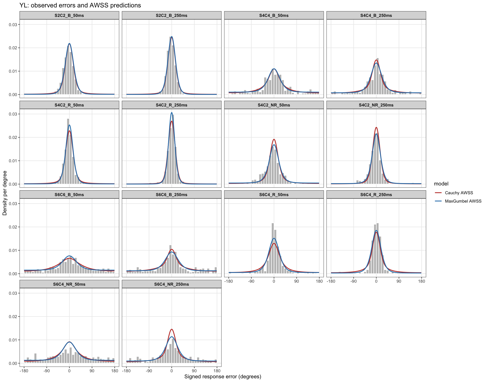

## Model constraints

Both models use 14 condition cells and 15 fitted parameters: two single-color
state-quality parameters at each encoding duration, ten display-and-duration
mixture weights, and one shared report/tuning parameter. R and NR targets from
the same display share `W`; their quality differs through the repeated-copy
factor *r*. For baseline and NR targets, *r* equals 1. For R targets,
*r* equals ItemN minus ColorN plus 1.

The Cauchy model scales each single-color dispersion by `sqrt(ColorN/r)`.
MaxGumbel scales each single-color amplitude by `sqrt(r/ColorN)`. In either
model, `W` is the probed target's better-state probability, with the
display-level average subset size `Kn_est = ColorN * W` under equal selection
of colors. The redundancy boost changes quality within a state; it does not
yet change `W` between R and NR targets.


``` r
source("cauchy_model.R")
source("MaxGumbelModel.R")
library(ggplot2)
ca <- readRDS("results/YL/cauchy_awss_fit.rds")
mg <- readRDS("results/YL/maxgumbel_awss_fit.rds")
stopifnot(identical(ca$cells$cell, mg$cells$cell),
          ca$trial_count == mg$trial_count)
trials <- read.csv("../Daz25EncodingData/PreliminaryReview/YL_model_trials.csv")
trials <- subset(trials, IsUsable == 1 & is.finite(Precision))
trials$ColorN <- ifelse(trials$RedundantN > 0,
                         trials$ItemN - trials$RedundantN + 1,
                         trials$ItemN)
trials$cell <- sprintf("S%dC%d_%s_%dms", trials$ItemN, trials$ColorN,
                       trials$ConditionType, round(1000 * trials$PresDur))
```

## Overall fit


``` r
summary <- data.frame(
  model = c("Cauchy AWSS", "MaxGumbel AWSS"),
  negative_ll = c(ca$total_negative_ll, mg$total_negative_ll),
  parameters = c(ca$parameter_count, mg$parameter_count),
  trials = c(ca$trial_count, mg$trial_count)
)
summary$AIC <- 2 * summary$negative_ll + 2 * summary$parameters
summary$BIC <- 2 * summary$negative_ll +
  log(summary$trials) * summary$parameters
knitr::kable(summary, digits = 3)
```


|model          | negative_ll| parameters| trials|      AIC|      BIC|
|:--------------|-----------:|----------:|------:|--------:|--------:|
|Cauchy AWSS    |    4829.701|         15|   4893| 9689.401| 9786.834|
|MaxGumbel AWSS |    4740.827|         15|   4893| 9511.655| 9609.088|

The AWSS MaxGumbel fit has a lower negative log likelihood by
88.87 units. Both models have the
same parameter count, so their AIC and BIC differences are twice that gap.
Relative to the earlier unconstrained 15-parameter fits, AWSS raises the
Cauchy negative log likelihood by
119.45
and MaxGumbel's by
50.07.
These are comparisons within each model, not a nested-model test: the
parameterizations differ even though the counts are equal.

## State values and subset weights


``` r
cat("Cauchy single-color dispersions; shared sensitivity:", ca$shared_value, "\n")
```

```
## Cauchy single-color dispersions; shared sensitivity: 20.86847
```

``` r
knitr::kable(ca$state_parameters, digits = 3)
```


| PresDur| attended_1| unattended_1|
|-------:|----------:|------------:|
|    0.05|      0.082|        0.377|
|    0.25|      0.054|        0.502|

``` r
cat("MaxGumbel single-color amplitudes; shared tuning kappa:", mg$shared_value, "\n")
```

```
## MaxGumbel single-color amplitudes; shared tuning kappa: 2.370809
```

``` r
knitr::kable(mg$state_parameters, digits = 3)
```


| PresDur| attended_1| unattended_1|
|-------:|----------:|------------:|
|    0.05|       4.50|        2.343|
|    0.25|       5.43|        2.778|

``` r
weights <- data.frame(W_group = ca$weights$W_group,
                      ColorN = ca$weights$ColorN,
                      Cauchy_W = ca$weights$W,
                      Cauchy_Kn = ca$weights$Kn_est,
                      MaxGumbel_W = mg$weights$W,
                      MaxGumbel_Kn = mg$weights$Kn_est)
knitr::kable(weights, digits = 3)
```


|W_group    | ColorN| Cauchy_W| Cauchy_Kn| MaxGumbel_W| MaxGumbel_Kn|
|:----------|------:|--------:|---------:|-----------:|------------:|
|S2C2_250ms |      2|    0.995|     1.990|       0.986|        1.972|
|S2C2_50ms  |      2|    0.995|     1.990|       0.995|        1.990|
|S4C2_250ms |      2|    0.986|     1.973|       0.661|        1.323|
|S4C2_50ms  |      2|    0.789|     1.577|       0.465|        0.930|
|S4C4_250ms |      4|    0.547|     2.187|       0.330|        1.320|
|S4C4_50ms  |      4|    0.317|     1.268|       0.265|        1.061|
|S6C4_250ms |      4|    0.531|     2.124|       0.090|        0.360|
|S6C4_50ms  |      4|    0.164|     0.657|       0.005|        0.020|
|S6C6_250ms |      6|    0.345|     2.071|       0.067|        0.401|
|S6C6_50ms  |      6|    0.041|     0.244|       0.005|        0.030|

Both Cauchy S2C2 weights reach the fitted upper bound of 0.995, corresponding
to `Kn_est = 1.99` of two colors. That is consistent with both colors commonly
entering the better state, but the upper-bound estimate should be read as
"near two," not as precise evidence for 1.99. MaxGumbel also reaches weight
bounds in some cells. The different subset estimates across models show that
`W` is partly dependent on the assumed state-quality and report functions.

## Cell-level likelihood differences


``` r
cells <- data.frame(cell = ca$cells$cell,
                    trials = ca$cells$trials,
                    cauchy_negative_ll = ca$cells$negative_ll,
                    maxgumbel_negative_ll = mg$cells$negative_ll)
cells$cauchy_minus_maxgumbel <- cells$cauchy_negative_ll -
  cells$maxgumbel_negative_ll
cells <- cells[order(-cells$cauchy_minus_maxgumbel), ]
knitr::kable(cells, digits = 3, row.names = FALSE)
```


|cell          | trials| cauchy_negative_ll| maxgumbel_negative_ll| cauchy_minus_maxgumbel|
|:-------------|------:|------------------:|---------------------:|----------------------:|
|S6C4_R_50ms   |    350|            311.310|               294.704|                 16.606|
|S6C4_R_250ms  |    350|            213.331|               196.998|                 16.333|
|S4C2_R_50ms   |    349|            111.962|               100.304|                 11.657|
|S6C4_NR_250ms |    348|            574.889|               563.349|                 11.540|
|S2C2_B_50ms   |    350|            173.148|               165.025|                  8.123|
|S6C4_NR_50ms  |    350|            642.059|               635.700|                  6.358|
|S2C2_B_250ms  |    350|            114.218|               110.087|                  4.131|
|S4C4_B_250ms  |    350|            436.667|               433.281|                  3.386|
|S4C2_R_250ms  |    349|             44.553|                41.281|                  3.272|
|S4C2_NR_50ms  |    349|            361.378|               358.808|                  2.570|
|S4C4_B_50ms   |    350|            499.032|               497.204|                  1.828|
|S4C2_NR_250ms |    349|            212.773|               211.364|                  1.408|
|S6C6_B_250ms  |    349|            547.079|               545.728|                  1.351|
|S6C6_B_50ms   |    350|            587.302|               586.994|                  0.308|

The largest Cauchy losses are in S6C4 R and NR conditions. This is a
descriptive decomposition of the jointly fitted likelihood; cell contributions
are not independently optimized.

## Far-error diagnostic


``` r
tail_mass <- function(pred) {
  h <- 2 * pi / length(pred$theta)
  sum(pred$ptheta[abs(pred$theta) >= pi / 2]) * h
}
far <- do.call(rbind, lapply(seq_len(nrow(ca$cells)), function(i) {
  a <- ca$cells[i, ]
  b <- mg$cells[i, ]
  ap <- cauAWSSreport(c(a$attended_1, a$unattended_1,
                        a$W, ca$shared_value),
                      N = a$ColorN, r = a$r)
  bp <- max_gumbel_awss_report(c(b$attended_1, b$unattended_1,
                                 b$W, mg$shared_value),
                               N = b$ColorN, r = b$r)
  data.frame(cell = a$cell,
             observed = mean(abs(trials$Precision[trials$cell == a$cell]) >= 90),
             cauchy = tail_mass(ap), maxgumbel = tail_mass(bp))
}))
knitr::kable(far[grepl("^S6C4", far$cell), ], digits = 3, row.names = FALSE)
```


|cell          | observed| cauchy| maxgumbel|
|:-------------|--------:|------:|---------:|
|S6C4_NR_250ms |    0.253|  0.151|     0.178|
|S6C4_NR_50ms  |    0.340|  0.197|     0.234|
|S6C4_R_250ms  |    0.046|  0.095|     0.054|
|S6C4_R_50ms   |    0.049|  0.121|     0.094|

For S6C4, both models tend to underpredict NR far errors and overpredict R
far errors; the contrast is larger for Cauchy. This pattern motivates a later
test in which redundant targets are more likely to enter the better state,
while preserving an interpretable display-level average subset size.
The 90-degree threshold is diagnostic only; the fitted likelihood uses
individual signed errors.

## Observed and predicted distributions


``` r
cell_order <- with(ca$cells,
  order(ItemN, match(ConditionType, c("B", "R", "NR")), PresDur))
cell_levels <- ca$cells$cell[cell_order]
trials$cell <- factor(trials$cell, levels = cell_levels)
curves <- do.call(rbind, lapply(seq_len(nrow(ca$cells)), function(i) {
  a <- ca$cells[i, ]
  b <- mg$cells[i, ]
  ap <- cauAWSSreport(c(a$attended_1, a$unattended_1,
                        a$W, ca$shared_value),
                      N = a$ColorN, r = a$r)
  bp <- max_gumbel_awss_report(c(b$attended_1, b$unattended_1,
                                 b$W, mg$shared_value),
                               N = b$ColorN, r = b$r)
  rbind(
    data.frame(cell = a$cell, error_deg = ap$theta * 180 / pi,
               density_deg = ap$ptheta * pi / 180,
               model = "Cauchy AWSS"),
    data.frame(cell = b$cell, error_deg = bp$theta * 180 / pi,
               density_deg = bp$ptheta * pi / 180,
               model = "MaxGumbel AWSS")
  )
}))
curves$cell <- factor(curves$cell, levels = cell_levels)
plot_awss <- ggplot(trials, aes(x = Precision)) +
  geom_histogram(aes(y = after_stat(density)), binwidth = 10,
                 boundary = -180, fill = "grey75", colour = "white") +
  geom_line(data = curves,
            aes(x = error_deg, y = density_deg, colour = model),
            linewidth = 0.8) +
  facet_wrap(~ cell, ncol = 4) +
  coord_cartesian(xlim = c(-180, 180)) +
  scale_x_continuous(breaks = c(-180, -90, 0, 90, 180)) +
  scale_colour_manual(values = c("Cauchy AWSS" = "#C13C32",
                                 "MaxGumbel AWSS" = "#2C7FB8")) +
  labs(x = "Signed response error (degrees)", y = "Density per degree",
       title = "YL: observed errors and AWSS predictions") +
  theme_bw(base_size = 11) +
  theme(panel.grid.minor = element_blank(),
        strip.text = element_text(face = "bold"))
print(plot_awss)
```



``` r
ggsave("results/YL/awss_predictions_YL.png", plot_awss,
       width = 14, height = 11, dpi = 150)
```

## Optimization check


``` r
audit <- do.call(rbind, lapply(list(ca, mg), function(f) {
  data.frame(model = f$model, starts = nrow(f$starts),
             converged = sum(f$starts$convergence == 0),
             within_1e_minus_4 = sum(abs(f$starts$negative_ll -
                                       f$total_negative_ll) < 1e-4),
             boundary_starts = sum(f$starts$boundary_hit))
}))
knitr::kable(audit)
```


|model          | starts| converged| within_1e_minus_4| boundary_starts|
|:--------------|------:|---------:|-----------------:|---------------:|
|cauchy_awss    |     50|        50|                50|              50|
|maxgumbel_awss |     50|        50|                 3|              50|

All 50 Cauchy starts recover the same solution to within 0.0001 negative
log-likelihood units. MaxGumbel has more variation across starts, although
most are close to its best result. Boundary hits reflect fitted `W` values;
they are relevant when interpreting estimated subset sizes.
