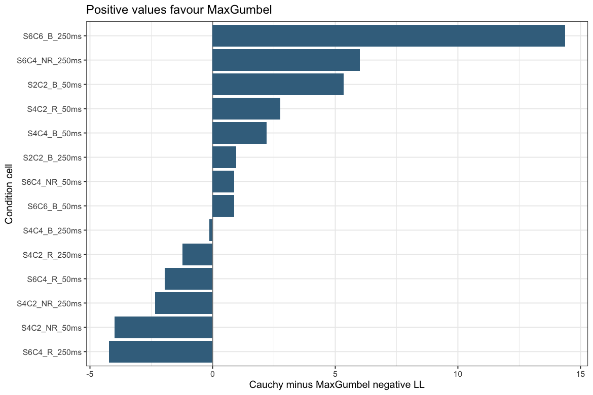
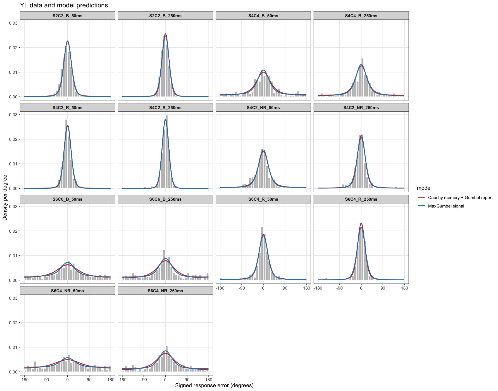

## Theoretical account

The Cauchy model treats the direction of the consolidated VWM representation
as a latent trial-level angle $z$ relative to the target. Across trials in
condition cell $c$, $z$ follows a wrapped Cauchy with dispersion $\kappa_c$.
Smaller $\kappa_c$ means that representation directions stay closer to the
target. Conditional on $z$, the 360 possible reports receive cosine utilities
centred on $z$. Independent unit-scale Gumbel noise and max selection are
evaluated through Luce probabilities. One decision sensitivity is shared
across cells. The predicted behavioural distribution averages the conditional
report distributions over all possible $z$ using circular convolution.

The comparison MaxGumbel model applies Gumbel-max/Luce choice directly to a
von Mises-shaped signal profile. It has one shared signal-shape parameter
$\kappa$ and one amplitude per condition cell; it does not separately represent
a trial-level consolidated direction. The two models each have 14 cell
parameters and one shared parameter. Their $\kappa$ estimates have different
meanings and should not be compared numerically.

These are unconstrained baseline fits. Neither model yet imposes the proposed
sample-size, redundancy, or attended-subset law. This notebook includes only
the consolidated-angle Cauchy model in [cauchy_model.R](cauchy_model.R) and
the comparison in [MaxGumbelModel.R](MaxGumbelModel.R).

## Data and fits


``` r
source("cauchy_model.R")
source("cauchy_runner.R")
source("MaxGumbelModel.R")
library(ggplot2)

trial_file <- file.path("..", "Daz25EncodingData", "PreliminaryReview",
                        paste0(params$participant, "_model_trials.csv"))
trials <- read.csv(trial_file)
result_dir <- file.path("results", params$participant)
dir.create(result_dir, recursive = TRUE, showWarnings = FALSE)

load_or_fit <- function(filename, fit_function, expected_model = NULL) {
  path <- file.path(result_dir, filename)
  if (!isTRUE(params$refit) && file.exists(path)) {
    cached <- readRDS(path)
    valid <- !is.null(cached$optimizer_settings$n_starts) &&
      cached$optimizer_settings$n_starts == params$n_starts &&
      (is.null(expected_model) || identical(cached$model, expected_model))
    if (valid) return(cached)
  }
  result <- fit_function(trials, n_starts = params$n_starts)
  saveRDS(result, path)
  result
}

cauchy_fit <- load_or_fit("cauchy_fit.rds", fit_cauchy_cells,
                          "cauchy_memory")
maxgumbel_fit <- load_or_fit("maxgumbel_fit.rds", fit_max_gumbel_cells,
                             "maxgumbel_shared_kappa")
stopifnot(identical(cauchy_fit$cells$cell, maxgumbel_fit$cells$cell),
          identical(cauchy_fit$cells$trials, maxgumbel_fit$cells$trials))
```

Both fits use trials with `IsUsable == 1` and finite signed errors. Errors
are converted from degrees to radians and evaluated at the nearest option
on the same 360-position grid. Both optimizers use 100
starts. Set `params$refit` to `true` to refit rather than load saved fits.

## Overall comparison


``` r
comparison <- data.frame(
  model = c("Cauchy memory + Gumbel report", "MaxGumbel signal"),
  negative_ll = c(cauchy_fit$total_negative_ll,
                  maxgumbel_fit$total_negative_ll),
  parameters = c(cauchy_fit$parameters,
                 maxgumbel_fit$parameter_count),
  trials = sum(cauchy_fit$cells$trials)
)
comparison$log_likelihood <- -comparison$negative_ll
comparison$AIC <- 2 * comparison$negative_ll + 2 * comparison$parameters
comparison$BIC <- 2 * comparison$negative_ll +
  log(comparison$trials) * comparison$parameters
comparison$delta_AIC <- comparison$AIC - min(comparison$AIC)
knitr::kable(comparison, digits = 3)
```


|model                         | negative_ll| parameters| trials| log_likelihood|      AIC|      BIC| delta_AIC|
|:-----------------------------|-----------:|----------:|------:|--------------:|--------:|--------:|---------:|
|Cauchy memory + Gumbel report |    4710.248|         15|   4893|      -4710.248| 9450.495| 9547.929|    38.989|
|MaxGumbel signal              |    4690.753|         15|   4893|      -4690.753| 9411.506| 9508.939|     0.000|

``` r
write.csv(comparison,
          file.path(result_dir, "cauchy_maxgumbel_comparison.csv"),
          row.names = FALSE)
```

With equal parameter counts, AIC and BIC differences are twice the
negative-log-likelihood difference. This is an in-sample comparison, not an
out-of-sample test or a test of AWSS constraints.


``` r
shared <- data.frame(
  model = comparison$model,
  parameter = c("decision sensitivity", "signal shape kappa"),
  estimate = c(cauchy_fit$sensitivity, maxgumbel_fit$kappa)
)
knitr::kable(shared, digits = 3)
```


|model                         |parameter            | estimate|
|:-----------------------------|:--------------------|--------:|
|Cauchy memory + Gumbel report |decision sensitivity |   18.713|
|MaxGumbel signal              |signal shape kappa   |    2.402|

``` r
cell_parameters <- data.frame(
  cell = cauchy_fit$cells$cell,
  trials = cauchy_fit$cells$trials,
  cauchy_memory_dispersion = cauchy_fit$cells$kappa,
  maxgumbel_signal_amplitude = maxgumbel_fit$cells$amplitude
)
knitr::kable(cell_parameters, digits = 3)
```


|cell          | trials| cauchy_memory_dispersion| maxgumbel_signal_amplitude|
|:-------------|------:|------------------------:|--------------------------:|
|S2C2_B_250ms  |    350|                    0.048|                      3.640|
|S2C2_B_50ms   |    350|                    0.088|                      3.155|
|S4C2_NR_250ms |    349|                    0.108|                      2.818|
|S4C2_NR_50ms  |    349|                    0.251|                      2.035|
|S4C2_R_250ms  |    349|                    0.021|                      4.474|
|S4C2_R_50ms   |    349|                    0.046|                      3.752|
|S4C4_B_250ms  |    350|                    0.344|                      1.682|
|S4C4_B_50ms   |    350|                    0.483|                      1.379|
|S6C4_NR_250ms |    348|                    0.706|                      1.060|
|S6C4_NR_50ms  |    350|                    1.234|                      0.624|
|S6C4_R_250ms  |    350|                    0.082|                      2.977|
|S6C4_R_50ms   |    350|                    0.163|                      2.385|
|S6C6_B_250ms  |    349|                    0.663|                      1.112|
|S6C6_B_50ms   |    350|                    0.900|                      0.863|

## Where Cauchy loses likelihood


``` r
cells <- data.frame(
  cell = cauchy_fit$cells$cell,
  trials = cauchy_fit$cells$trials,
  cauchy_negative_ll = cauchy_fit$cells$negative_ll,
  maxgumbel_negative_ll = maxgumbel_fit$cells$negative_ll
)
cells$cauchy_minus_maxgumbel <-
  cells$cauchy_negative_ll - cells$maxgumbel_negative_ll
cells <- cells[order(-cells$cauchy_minus_maxgumbel), ]
row.names(cells) <- NULL
knitr::kable(cells, digits = 3)
```


|cell          | trials| cauchy_negative_ll| maxgumbel_negative_ll| cauchy_minus_maxgumbel|
|:-------------|------:|------------------:|---------------------:|----------------------:|
|S6C6_B_250ms  |    349|            560.199|               545.825|                 14.374|
|S6C4_NR_250ms |    348|            559.173|               553.169|                  6.004|
|S2C2_B_50ms   |    350|            170.290|               164.954|                  5.336|
|S4C2_R_50ms   |    349|            101.802|                99.051|                  2.751|
|S4C4_B_50ms   |    350|            498.859|               496.659|                  2.200|
|S2C2_B_250ms  |    350|            111.048|               110.093|                  0.954|
|S6C4_NR_50ms  |    350|            615.638|               614.760|                  0.878|
|S6C6_B_50ms   |    350|            587.551|               586.678|                  0.873|
|S4C4_B_250ms  |    350|            432.495|               432.635|                 -0.140|
|S4C2_R_250ms  |    349|             41.856|                43.080|                 -1.224|
|S6C4_R_50ms   |    350|            284.966|               286.928|                 -1.962|
|S4C2_NR_250ms |    349|            209.690|               212.026|                 -2.336|
|S4C2_NR_50ms  |    349|            351.850|               355.842|                 -3.992|
|S6C4_R_250ms  |    350|            184.832|               189.053|                 -4.221|

``` r
write.csv(cells, file.path(result_dir, "cauchy_maxgumbel_cells.csv"),
          row.names = FALSE)

worst_cell <- cells$cell[1]
worst_gap <- cells$cauchy_minus_maxgumbel[1]
total_gap <- sum(cells$cauchy_minus_maxgumbel)
```

Positive differences favour MaxGumbel. The largest Cauchy loss is in
**S6C6_B_250ms**: 14.37 negative-log-likelihood
units, or 73.7% of the net
19.49-unit gap across all cells. Several cells favour
Cauchy and offset part of this loss.


``` r
ggplot(cells, aes(x = reorder(cell, cauchy_minus_maxgumbel),
                  y = cauchy_minus_maxgumbel)) +
  geom_hline(yintercept = 0, colour = "grey55") +
  geom_col(fill = "#3E708D") +
  coord_flip() +
  labs(x = "Condition cell", y = "Cauchy minus MaxGumbel negative LL",
       title = "Positive values favour MaxGumbel") +
  theme_bw(base_size = 11)
```



### Far-error check in the largest-loss cell


``` r
usable <- subset(trials, IsUsable == 1 & is.finite(Precision))
usable$ColorN <- ifelse(usable$RedundantN > 0,
                        usable$ItemN - usable$RedundantN + 1,
                        usable$ItemN)
usable$cell <- sprintf("S%dC%d_%s_%dms", usable$ItemN, usable$ColorN,
                       usable$ConditionType,
                       round(1000 * usable$PresDur))
worst_trials <- usable[usable$cell == worst_cell, ]
c_row <- cauchy_fit$cells[match(worst_cell, cauchy_fit$cells$cell), ]
m_row <- maxgumbel_fit$cells[
  match(worst_cell, maxgumbel_fit$cells$cell), ]
c_pred <- caureport(c(c_row$kappa, cauchy_fit$sensitivity), 360L)
m_pred <- max_gumbel_report(
  c(m_row$amplitude, maxgumbel_fit$kappa), 360L)
tail_mass <- function(pred, cutoff_deg = 90) {
  h <- 2 * pi / length(pred$theta)
  sum(pred$ptheta[abs(pred$theta) >= cutoff_deg * pi / 180]) * h
}
far_errors <- data.frame(
  distribution = c("Observed", comparison$model),
  fraction_at_least_90_deg = c(
    mean(abs(worst_trials$Precision) >= 90),
    tail_mass(c_pred), tail_mass(m_pred))
)
knitr::kable(far_errors, digits = 3)
```


|distribution                  | fraction_at_least_90_deg|
|:-----------------------------|------------------------:|
|Observed                      |                    0.289|
|Cauchy memory + Gumbel report |                    0.203|
|MaxGumbel signal              |                    0.240|

In this cell, Cauchy predicts fewer errors at least 90 degrees from the
target (20.3%)
than MaxGumbel (24.0%);
the observed fraction is 28.9%.
This 90-degree threshold is a descriptive diagnostic. The likelihood was
fitted to individual errors, not to this threshold statistic, so tail mass
alone need not account for the entire cell difference.

## Observed and predicted distributions


``` r
cell_order <- with(cauchy_fit$cells,
  order(ItemN, match(ConditionType, c("B", "R", "NR")), PresDur))
cell_levels <- cauchy_fit$cells$cell[cell_order]
usable$cell <- factor(usable$cell, levels = cell_levels)

prediction_data <- do.call(rbind, lapply(seq_len(nrow(cauchy_fit$cells)),
  function(i) {
    c_row <- cauchy_fit$cells[i, ]
    m_row <- maxgumbel_fit$cells[i, ]
    c_curve <- caureport(c(c_row$kappa, cauchy_fit$sensitivity), 360L)
    m_curve <- max_gumbel_report(
      c(m_row$amplitude, maxgumbel_fit$kappa), 360L)
    rbind(
      data.frame(cell = c_row$cell,
                 error_deg = c_curve$theta * 180 / pi,
                 density_deg = c_curve$ptheta * pi / 180,
                 model = comparison$model[1]),
      data.frame(cell = m_row$cell,
                 error_deg = m_curve$theta * 180 / pi,
                 density_deg = m_curve$ptheta * pi / 180,
                 model = comparison$model[2])
    )
  }))
prediction_data$cell <- factor(prediction_data$cell, levels = cell_levels)

ggplot(usable, aes(x = Precision)) +
  geom_histogram(aes(y = after_stat(density)), binwidth = 10,
                 boundary = -180, fill = "grey75", colour = "white") +
  geom_line(data = prediction_data,
            aes(x = error_deg, y = density_deg, colour = model),
            linewidth = 0.8) +
  facet_wrap(~ cell, ncol = 4) +
  coord_cartesian(xlim = c(-180, 180)) +
  scale_x_continuous(breaks = c(-180, -90, 0, 90, 180)) +
  scale_colour_manual(values = c(
    "Cauchy memory + Gumbel report" = "#C13C32",
    "MaxGumbel signal" = "#2C7FB8")) +
  labs(x = "Signed response error (degrees)",
       y = "Density per degree",
       title = paste(params$participant, "data and model predictions")) +
  theme_bw(base_size = 11) +
  theme(panel.grid.minor = element_blank(),
        strip.text = element_text(face = "bold"))
```



## Optimization audit


``` r
audit <- do.call(rbind, lapply(list(cauchy_fit, maxgumbel_fit),
  function(fitted) {
    starts <- fitted$starts
    data.frame(
      model = if (identical(fitted$model, "cauchy_memory"))
        comparison$model[1] else comparison$model[2],
      starts = nrow(starts),
      converged = sum(starts$convergence == 0),
      within_1e_minus_4_of_best = sum(
        abs(starts$negative_ll - fitted$total_negative_ll) < 1e-4),
      boundary_hits = sum(starts$boundary_hit),
      worst_negative_ll_gap = max(
        starts$negative_ll - fitted$total_negative_ll)
    )
  }))
knitr::kable(audit, digits = 6)
```


|model                         | starts| converged| within_1e_minus_4_of_best| boundary_hits| worst_negative_ll_gap|
|:-----------------------------|------:|---------:|-------------------------:|-------------:|---------------------:|
|Cauchy memory + Gumbel report |    100|       100|                       100|             0|              0.000001|
|MaxGumbel signal              |    100|       100|                        95|             0|             56.552680|

``` r
write.csv(audit,
          file.path(result_dir, "cauchy_maxgumbel_optimizer_audit.csv"),
          row.names = FALSE)
```

The best MaxGumbel solution was recovered by
95 of 100 starts.
The other starts converged to poorer local solutions; optimizer convergence
alone is therefore insufficient. The repeated best result supports stability
over the tested range, but does not prove a global optimum. These
unconstrained estimates provide a baseline for later AWSS models.
